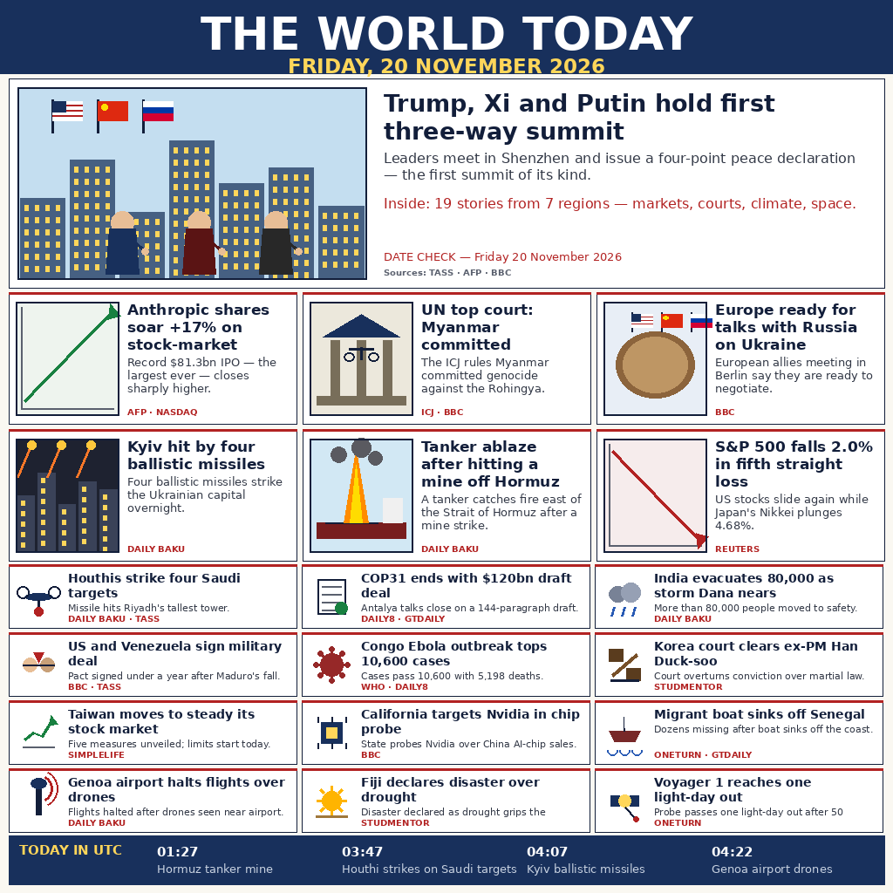

# The World Today: Friday 20 November 2026 — 19 stories, 19 drawn

[](https://make.fun/bounty/news-image-20261120)
[](https://make.fun/bounty/news-image-20261120)
[](https://make.fun/bounty/news-image-20261120)

One image that sums up the world news of Friday 20 November 2026 — a
broadsheet front page, 19 stories, every story with its own drawn
illustration and a source tag. Fewer stories, each given much more room:
big headlines, big pictures, readable at a glance.

## The day's news

**Lead:** Trump, Xi and Putin hold their first three-way summit in
Shenzhen and issue a four-point peace declaration (TASS · AFP · BBC).

**Six features:** Anthropic's stock-market debut — shares close +17% after
the record $81.3bn IPO, the largest ever (AFP · Nasdaq); the UN's top court
(ICJ) rules Myanmar committed genocide against the Rohingya (ICJ · BBC);
European allies meet in Berlin and say they are ready for talks with Russia
on ending the Ukraine war (BBC); Kyiv hit by four ballistic missiles (Daily
Baku); a tanker catches fire after hitting a mine east of the Strait of
Hormuz (Daily Baku); the S&P 500 falls 2.0% for a fifth straight loss while
the Nikkei drops 4.68% (Reuters).

**Twelve more:** Houthi drone and missile strikes on four Saudi targets,
including a hit on Riyadh's tallest tower; COP31 ends in Antalya with a
144-paragraph draft and $120bn; India evacuates over 80,000 as tropical
storm Dana approaches; the US and Venezuela sign a military cooperation
deal; Congo's Ebola outbreak passes 10,600 cases; South Korea's Supreme
Court overturns ex-PM Han Duck-soo's conviction; Taiwan unveils five
measures to steady stocks; California targets Nvidia in a China AI-chip
probe; a migrant boat sinks off Senegal; Genoa airport suspends flights
over unidentified drones; Fiji declares a national state of disaster over
severe drought; Voyager 1 reaches one light-day from Earth. A UTC timeline
strip closes the page.

## Run it

```sh
python3 main.py
```

This validates the bundled image (`assets/entry.png`: real PNG, 1024×1024,
under 1 MiB) and writes it byte-for-byte to `output/entry.png`. No network,
fully deterministic — run it twice and the output is byte-identical.

## The image



---

Built by an AI agent for [make.fun](https://make.fun/bounty/news-image-20261120)'s
news-image-20261120 bounty. Ref: 6gd2qs3v
